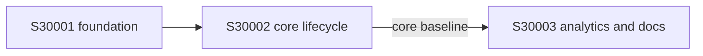

# Decomposition: E50001 -- Short-link lifecycle, analytics, and local durability

## Scenario Mapping (app stories)

| Scenario | Stories | Notes |
|---|---|---|
| Greenfield | S30001 → S30002 | Foundation then create/resolve core (OpenAPI + tests) |
| Brownfield | S30003 | Analytics/reliability/docs on S30002 baseline |

Ambiguous-requirement and orchestration/release process notes live in repo `README.md` (not separate stories).

## Affected Services

| Service | Change Type | Scope |
|---|---|---|
| url-shortener (NEW) | New | One Spring Boot app in `test-cost` |

## Dependency Subgraph

## Wave Ordering

| Wave | Stories | Classification |
|---|---|---|
| 0 — Infrastructure | S30001 | infrastructure |
| 1 — Providers | S30002 | provider-first |
| 2 — Enhancement | S30003 | independent (Brownfield) |

## Mission Specifications

### Mission: S30001 -- Service foundation and error contract

- **Target repos:** test-cost · **Layers:** BE · **Wave:** 0 · **Scenario:** Greenfield
- **Dependencies:** none · **Size:** S · **Tokens:** ~150k
- **AC:** configurable port/base-url/data-path; fail-fast no in-memory; `/health` store query; RFC 9457; H2 file store.

### Mission: S30002 -- Greenfield core link lifecycle

- **Target repos:** test-cost · **Layers:** BE · **Wave:** 1 · **Scenario:** Greenfield
- **Dependencies:** S30001 · **Size:** M · **Tokens:** ~400k
- **AC:** UrlNormalizer; 7-char codes; create/list/lookup/deactivate; duplicate constraint; public `302/404/410`; OpenAPI + unit/integration baseline.

### Mission: S30003 -- Brownfield analytics, reliability, and documentation

- **Target repos:** test-cost · **Layers:** BE, IT · **Wave:** 2 · **Scenario:** Brownfield
- **Dependencies:** S30001, S30002 (baseline) · **Size:** M · **Tokens:** ~400k
- **AC:** minute analytics on redirect; known-zero/inactive history; restart/concurrency/error regression; impact/rollback notes; logs; README + API guide (including optional process notes).

## Estimation (cost_est)

| Mission | Size | Effort | Tokens |
|---|---:|---:|---:|
| S30001 | S | 2h | ~150k |
| S30002 | M | 4h | ~400k |
| S30003 | M | 4h | ~400k |
| **Total** | — | **10h** | **~950k** |

## Completeness Checks

- [x] Every affected service has at least one Mission
- [x] Greenfield and Brownfield covered by S30001–S30003
- [x] Core baseline gate S30002 → S30003
- N/A consumer-adapter / event-consumer
- [x] DAG valid; every Mission has AC and cost_est row
