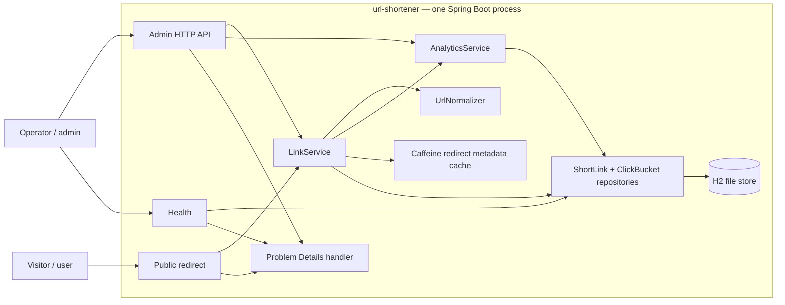
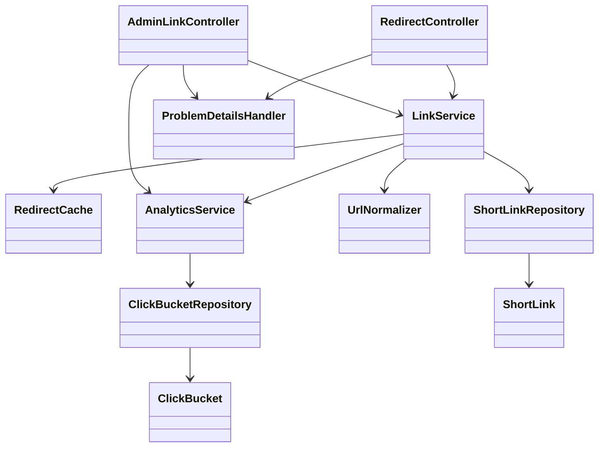
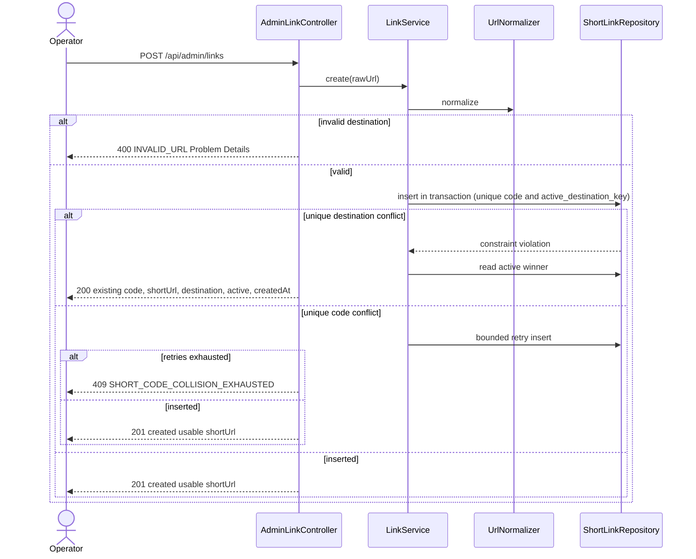
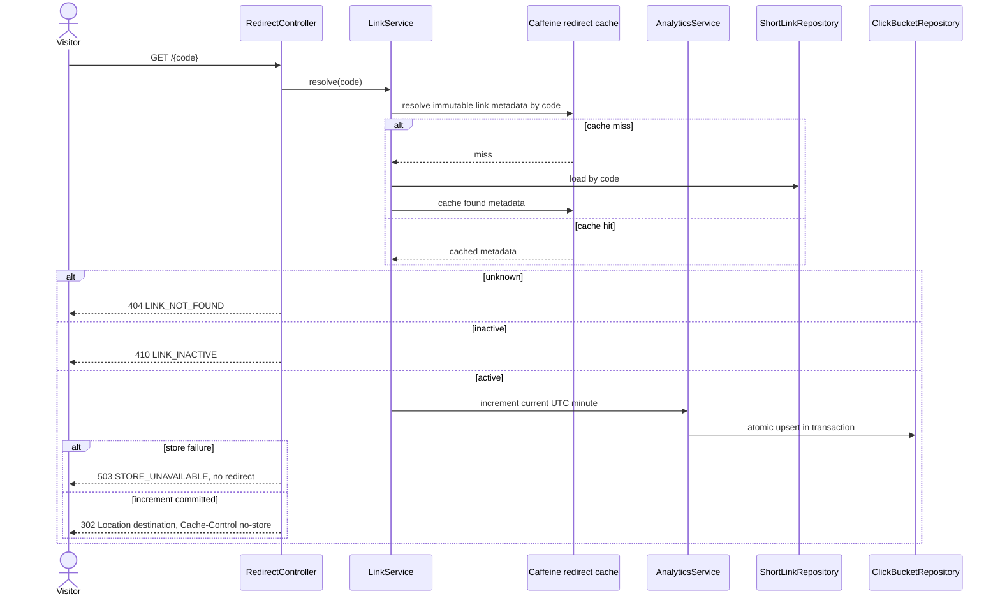
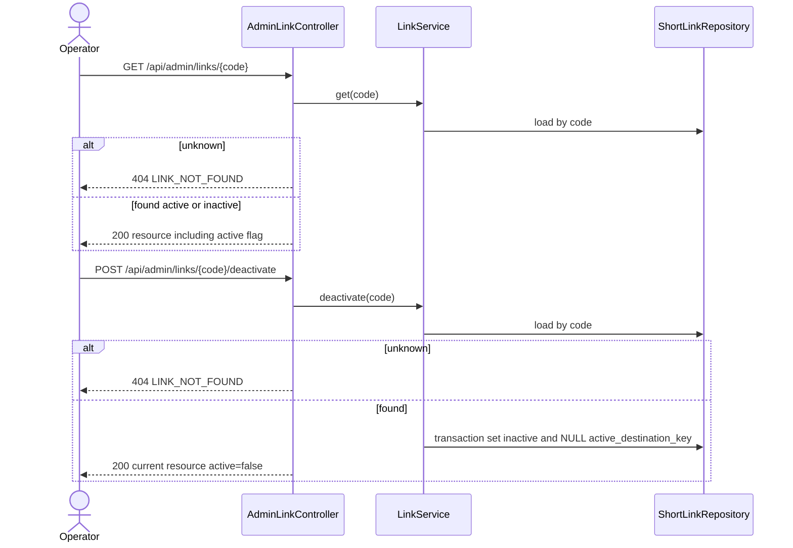
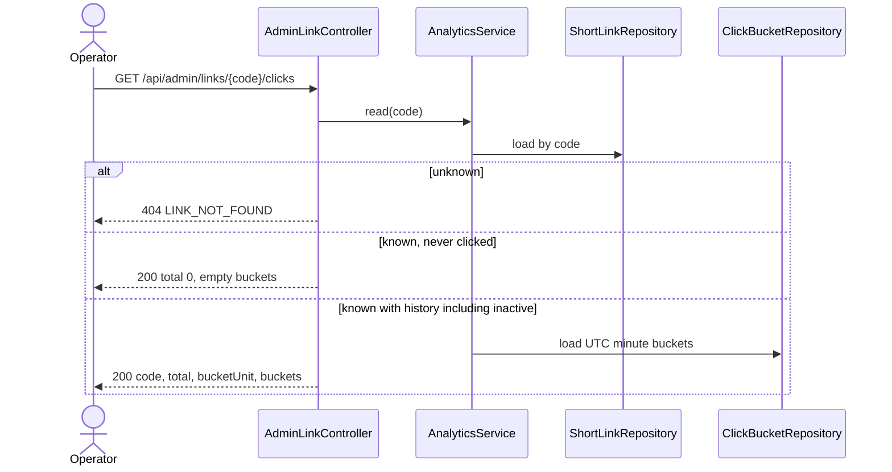

# Solution Architecture (HLD): url-shortener — Short-link lifecycle, analytics, and local durability

Traces to: `../outcome-spec.md` and `./capability-spec.md`

**Source:** created **Authoritative:** this file

## Functional Overview

One Spring Boot process on one machine serves operator/admin and visitor/user HTTP surfaces. Short links, active/inactive state, and UTC minute-bucketed click counts live in an embedded H2 file database so they survive a single process restart. S30004 adds a bounded, in-process Caffeine cache for redirect metadata; H2 remains authoritative and the cache is disposable across restarts. This is a local single-system deployment; it is not distributed-ready.

**In scope** (from the capability spec — not redefined here): create a usable short URL; public resolve; admin lookup/list/deactivate; UTC minute analytics including known-zero; durable H2 file; health that queries the store; duplicate-create safety; RFC 9457 errors; operator documentation after implementation; and the bounded local redirect cache in S30004. Actuator liveness/readiness probes are included as an additive operations enhancement while preserving the original `/health` contract.

**Out of scope:** auth/RBAC; external DB and horizontal scale; distributed ID/code allocation and shared cache; async analytics/events and richer dimensions; custom domains, expiry, rate limit, abuse controls, destination fetch / URL-safety blocklist; broad metrics/tracing/SLOs; backup/restore/HA/multi-region; product web UI; billing; cluster. A built-in local target page, if added at all, is an optional developer convenience at the end of delivery and is not a correctness dependency.

### Functional assumptions

- Java / Spring Boot, one JVM, one listen port.
- No authentication. `/api/admin/**` is a namespace, not an enforced role.
- Destinations are never fetched (no SSRF). Trailing slash, path, and query are significant.
- Correctness target is bounded side-project scope on one machine.
- The redirect cache exists only inside this process, is bounded and time-limited, and is never the durable source of truth.

## Design Considerations

- **Runtime:** one Spring Boot process; operator and visitor share it; no auth.
- **Store:** H2 file mode only. Configurable stable data path; default `./data/url-shortener` relative to the documented working directory. Create the directory if missing. Never fall back to in-memory. Startup fails fast if the store cannot be opened. Runtime health is DOWN / `503` if a store query fails.
- **Probes:** Spring Boot Actuator exposes only the health endpoint over HTTP. Liveness reports application availability only; readiness includes application readiness and the H2 `db` health contributor. `/livez` and `/readyz` are mapped on the main application port. Existing `/health` keeps its store-query response contract.
- **Create:** `POST /api/admin/links` returns a usable `shortUrl` built from a configured base URL (local default `http://localhost` + configured port). Never derive the base from the `Host` header.
- **Duplicate create:** at most one active row per normalized destination, enforced in the database (`active_destination_key`), not check-then-insert. Concurrent loser reads the winner and returns `200`.
- **Redirect:** HTTP `302` + `Cache-Control: no-store`. Count an active redirect only after the increment transaction commits; store failure → `503` and no redirect.
- **Redirect lookup cache (S30004):** cache only immutable code/destination/active metadata used by public redirect resolution. Use Caffeine with a configurable maximum size and write TTL; do not cache analytics, admin/list results, or unknown codes. Commit-aware deactivation invalidation prevents a stale active value from being reinserted by a concurrent cache miss. The HTTP response remains `Cache-Control: no-store`.
- **Analytics:** UTC minute buckets (`bucketStart`, `count`) plus code, total, `bucketUnit`. Known-zero is `200` / total `0` / empty buckets. Inactive known links remain readable. Unknown is `404`.
- **Deactivate:** idempotent for a known code; `200` with current resource; clear `active_destination_key`. Recreating that destination mints a new code; old history stays on the old code.
- **Errors:** `application/problem+json` (RFC 9457). Never leak stack traces, SQL, filesystem paths, or destination secrets.
- **Docs:** after implementation, developer README and user/API guide. Do not prescribe a build command until the build tool is selected.

## POC Artifacts Reviewed

None.

## Solution Overview

A single module with HTTP adapters, a small domain/application layer, and Spring Data / JDBC access to H2.

### Logical layout (implementation may rename packages, not responsibilities)

- **HTTP:** `AdminLinkController`, `RedirectController`, health endpoint, `ProblemDetails` handler
- **Operations:** Spring Boot Actuator health contributors and liveness/readiness groups
- **Application:** `LinkService`, `AnalyticsService`, `UrlNormalizer`
- **Persistence:** `ShortLinkRepository`, `ClickBucketRepository`; entities `ShortLink`, `ClickBucket`
- **Store:** H2 file under the configured data path

### Technical assumptions

- Default port `8080` (configurable). Default base URL `http://localhost:${server.port}`.
- JDBC URL is derived from `app.data-path` (default `./data/url-shortener`). File name under that directory is an implementation detail; the directory is the stable, documented path.
- Schema is created by the application at startup for this bounded scope (no external migration product).
- Build tool (Maven vs Gradle) is an implementation choice; README records the start command after that choice.

## Design Options

| Option | Summary | Pros | Cons |
|---|---|---|---|
| A — one Spring Boot process + H2 file | Single JVM; file store next to process | Matches one-machine scope; restart-durable; no extra server; operator and visitor share one process | Single-process only; not a cluster story |
| B — Spring Boot + standalone database | App process plus a separate database server | Stronger isolation if this later grows | Extra process, extra failure mode, heavier than in-scope needs; implies migrations/ops not in this project |

**Recommendation: Option A.** Smallest design that meets durability, one-process operator+visitor, and “no separate server.” Option B is future scope (external DB + migrations + stateless scale).

Synchronous analytics (increment committed before `302`) is required for strong correctness on Option A. Async/event analytics is future scope.

### Future Scope: Multi-instance Scale

The current deployment targets one process and one local H2 file. S30004 covers
only a local cache for that topology. It has no million-user throughput or
latency guarantee, and no load-test evidence. Before horizontal scale, database
and cache changes must be planned, validated, and released together as one
future scale-out work item; neither is an independent prerequisite to the
other:

- **Database and shared-cache migration (one coupled change):** migrate from H2
  file storage to a managed/server database, define schema migrations and
  connection-pool limits, and make application instances stateless. As part of
  that same change, adopt a shared cache (for example Redis) and define
  cross-instance cache-fill/invalidation ordering, TTL fallback, and deactivation
  consistency. Do not roll out a distributed cache separately from the database
  migration, or scale app instances while they depend on H2 file storage.
- **Database access paths:** measure real query plans and add indexes for active
  destination uniqueness, active-list filtering, and the keyset order
  `(created_at, code)`. Keep pagination cursor-based as the link table grows.
- **Scale-out gate:** begin the coupled database/shared-cache work only when
  measured traffic or availability requirements justify multiple instances.
  Preserve the public redirect contract and require that a successful
  deactivation prevents subsequent redirect resolutions from serving the old
  active value. HTTP `Cache-Control: no-store` remains independent of internal
  caching. Do not cache click counters as link metadata.
- **Analytics throughput:** benchmark concurrent redirects to the same popular
  code. If synchronous minute-bucket updates contend, consider a durable event
  or atomic/sharded-counter design. Preserve increment-commit-before-`302` unless
  a reviewed contract change explicitly permits weaker counting semantics.
- **Analytics history:** bound or paginate long bucket histories and define
  retention/downsampling for older data.
- **Code allocation:** retain database uniqueness as the correctness boundary;
  evaluate coordinated/distributed allocation only if measured creation volume
  makes random generation and bounded collision retries insufficient.
- **Production hardening:** define authentication/authorization, rate limits,
  observability and SLOs, backup/recovery, and availability requirements before
  exposing the service to production traffic.

These are future-scope items, not requirements or guarantees of the current
local deployment. Each requires workload measurements and an explicit update to
the affected acceptance criteria before implementation.

## Component Diagram

Recommended option only. All components run in one process. New unless noted.





`ShortLink` holds code, normalized destination, active, createdAt, and nullable `activeDestinationKey` (normalized destination while active; NULL when inactive). `ClickBucket` holds code, UTC `bucketStart` (minute), and count.

## Sequence Diagrams

Recommended option only. High-level; no implementation code.

### Create (normalization, unique destination, concurrent loser → 200)



### Redirect (count after commit; store failure → 503, no redirect)



### Admin lookup and deactivate



### Analytics (known-zero and inactive history)



**Restart durability (narrative):** after a successful create, the H2 file remains on disk when the process stops. On start, the process reopens the same configured path. `GET /{code}` for an active code still returns `302`; click history remains readable. In-memory H2 is rejected.

## Capabilities and NFRs

| Capability ID | Capability | NFRs (performance, security, availability, scalability, observability, compatibility) | Priority |
|---|---|---|---|
| C-01a | Create usable short URL | Security: no auth now; never trust host; never fetch destination. Compatibility: absolute `http`/`https` only. Observability: structured create/reject logs (no full destination query string) | Must |
| C-01b | Public resolve + analytics | Performance: one local process with bounded redirect metadata cache. Strong correctness: increment commits before `302`. Availability: store failure → `503`, no redirect. HTTP cache: `Cache-Control: no-store`. No distributed cache | Must |
| C-01c | Admin manage + durability | Availability: H2 file on stable path; startup fail-fast; `/health` queries store. Scalability: single machine only. Observability: structured deactivate and store-error logs; optional `traceId` | Must |

## Integration Points

| ID | Integration | Direction | Contract surface |
|---|---|---|---|
| I-01 | Operator HTTP | In | `/api/admin/links` family — unauthenticated namespace |
| I-02 | Visitor HTTP | In | `GET /{code}` — public redirect |
| I-03 | Health HTTP | In | `GET /health` — unauthenticated store probe |
| I-04 | H2 file | Out (embedded) | JDBC file under configured data path |
| I-05 | Actuator probes | In | `/actuator/health/liveness`, `/actuator/health/readiness`, `/livez`, and `/readyz`; only health is exposed over HTTP |
| I-06 | Redirect metadata cache | In-process | Caffeine cache keyed by short code; H2 remains authoritative |

No other processes, identity providers, or message buses.

## REST API Design

| Topic | Coverage |
|---|---|
| Contract placement | Spring controllers plus an OpenAPI contract delivered with the Greenfield core baseline. Contract validation keeps paths, DTOs, statuses, and Problem Details aligned with the implementation |
| Bounded context | One URL-shortener context. Public resolve is `GET /{code}`; all management and analytics are under `/api/admin` |
| Resource design | Collection `/api/admin/links`; item `/api/admin/links/{code}`; deactivate as `POST .../{code}/deactivate`; public code is the short-code resource |
| List endpoints | `GET /api/admin/links?limit=&cursor=&active=` — default `limit=20`, max 100, cursor-based newest-first traversal ordered by `createdAt` and code. `active` filter is included (cheap column predicate) |
| Versioning | N/A — first version of a new service; no version prefix |
| Error model | `application/problem+json` RFC 9457. Fields: `type`, `title`, `status`, `detail`, `instance`, `code`, `timestamp`; `validationErrors[{field,message}]` when applicable; optional `traceId`. See Rainy Day Scenarios for exact status/code pairs |
| Idempotency | Create is naturally idempotent for an active normalized destination (`200` existing). Deactivate is idempotent for a known code (`200` current resource). No `Idempotency-Key` header |
| Timeouts | N/A as a product SLA. Local process; default servlet timeouts. Destinations are not fetched, so no outbound read timeout |
| Public exposure | Public: `GET /{code}`, `/health`, and Actuator health probes. Only the health endpoint is exposed over HTTP and health details are hidden. Admin: `/api/admin/**` (unauthenticated namespace, not a gateway/role split) |
| AuthN/AuthZ | None in this scope. Full RBAC is future scope. Namespace separation only |
| Rate limiting | N/A — future scope |
| Observability | Structured logs on create, redirect outcome, deactivate, rejection, store error. Avoid logging full destination query strings. Include `traceId` when present. Cache statistics are available to the in-process metrics registry; no additional Actuator HTTP endpoint is exposed in S30004 |
| Contract BWC | New service. Later auth or extra fields should be additive. Public path `GET /{code}` stays stable |

### HTTP surface (normative)

| Method | Path | Success | Notes |
|---|---|---|---|
| POST | `/api/admin/links` | `201` new / `200` existing active | Body: `{"destination":"<url>"}`. Response: code, shortUrl, destination, active, createdAt. `400 INVALID_URL` |
| GET | `/api/admin/links` | `200` cursor page | Optional `limit` (default 20, max 100), `cursor`, and `active`; response has `links` and nullable `nextCursor`; order is `createdAt DESC, code DESC`; malformed cursor is `400 INVALID_CURSOR` |
| GET | `/api/admin/links/{code}` | `200` current resource | Lookup. Inactive is `200 active=false`. `404` unknown |
| POST | `/api/admin/links/{code}/deactivate` | `200` current resource | Idempotent. Unknown `404` |
| GET | `/api/admin/links/{code}/clicks` | `200` | UTC minute buckets. Known-zero: total 0, empty buckets. Inactive known: history retained. Unknown `404` |
| GET | `/{code}` | `302` + Location + `Cache-Control: no-store` | Public. Unknown `404`; inactive `410`; increment failure `503` (no redirect) |
| GET | `/health` | `200 {"status":"UP"}` | Unauthenticated. Lightweight store query. Failure: `503 STORE_UNAVAILABLE` Problem Details |
| GET | `/actuator/health/liveness`, `/livez` | `200` | Process liveness only; does not depend on H2 |
| GET | `/actuator/health/readiness`, `/readyz` | `200` / `503` | Readiness state plus the H2 `db` health contributor; `503` when either is DOWN |
| GET | `/actuator/health` | `200` / `503` | Overall Actuator health; details remain hidden |

`shortUrl` = configured base URL (no trailing slash) + `/` + code. Local default base is `http://localhost:${configured port}`.

### Analytics JSON (success)

```json
{
  "code": "string",
  "total": 0,
  "bucketUnit": "minute",
  "buckets": [
    {
      "bucketStart": "ISO-8601 UTC minute",
      "count": 0
    }
  ]
}
```

`bucketStart` is ISO-8601 UTC truncated to the minute.

## Contract and Schema Direction

| Surface | Direction |
|---|---|
| XSD/WSDL | N/A — REST only |
| REST/Swagger | OpenAPI is required for the Greenfield core baseline; JSON requests/responses and errors align with REST API Design and Rainy Day Scenarios |
| DB | Two tables (names illustrative): `short_link` (code PK, destination, active, created_at, `active_destination_key` UNIQUE nullable); `click_bucket` (code, bucket_start, count) with unique `(code, bucket_start)`. H2 file. No in-memory fallback. No external migration product in this scope |
| Elasticsearch | N/A |

**H2 uniqueness strategy:** `active_destination_key` stores the normalized destination while the row is active and `NULL` when inactive. A unique constraint on that column yields at most one active link per destination; multiple inactive rows may share `NULL`. `code` is separately unique.

## Configurations

| Key | Default | Notes |
|---|---|---|
| `server.port` | `8080` | Listen port |
| `app.base-url` | `http://localhost:${server.port}` | Used to mint `shortUrl`; never from Host |
| `app.data-path` | `./data/url-shortener` | Relative to documented working directory; create if missing; fail startup if unusable |
| `app.cache.redirect.max-size` | `10000` | Maximum entries; configurable and bounded |
| `app.cache.redirect.ttl` | `5m` | Expire after write; initial default to tune from measured workload |

No secrets store, no remote config, no init-data product. Document reset/cleanup as “stop the process and delete the data directory” (or equivalent) in the README.

## Rainy Day Scenarios

All error responses: `Content-Type: application/problem+json` with `type`, `title`, `status`, `detail`, `instance`, `code`, `timestamp`; `validationErrors` on validation failures; optional `traceId`.

`type = urn:url-shortener:problem:<code>`.

| HTTP | code | title | When | detail (stable) |
|---:|---|---|---|---|
| 400 | `INVALID_URL` | Invalid URL | Destination missing, malformed, or not allowed | The destination URL is missing, malformed, or not allowed. |
| 400 | `INVALID_CURSOR` | Invalid cursor | Malformed or oversized cursor on admin list | The list cursor is malformed. |
| 404 | `LINK_NOT_FOUND` | Link not found | Unknown code on public or admin | No short link exists for the given code. |
| 410 | `LINK_INACTIVE` | Link inactive | Public `GET /{code}` when inactive | This short link has been deactivated. |
| 409 | `SHORT_CODE_COLLISION_EXHAUSTED` | Short code collision exhausted | Unique code retries exhausted | A unique short code could not be allocated after bounded retries. |
| 500 | `INTERNAL_ERROR` | Internal error | Unexpected failure | The request could not be completed. |
| 503 | `STORE_UNAVAILABLE` | Store unavailable | Store query/write failed, including health and failed analytics commit before redirect | The data store is not reachable. |

`INVALID_URL` includes `validationErrors: [{"field":"destination","message":"<reason>"}]` using the same public reasons as normalization (no credential echo).

### Race / concurrency

- Two concurrent creates of the same normalized destination: one insert wins; the other hits unique `active_destination_key`, reads the winner, returns `200`.
- Create after deactivate: new insert succeeds (old key is `NULL`); new code; `201`.
- Code collision: retry up to 5 times; then `409 SHORT_CODE_COLLISION_EXHAUSTED` (not `500` — allocation failed as a conflict, not an unknown crash).
- Redirect vs deactivate: whichever transaction commits last is visible; an in-flight increment that loaded active may still count that one visit; after deactivate, public resolve returns `410` and does not count.
- Analytics upsert: atomic increment of `(code, bucket_start)` in the same transaction that must commit before `302`.

Admin lookup of inactive is not an error (`200`). Inactive analytics is not an error (`200`).

## Backward Compatibility (BWC)

N/A as a breaking change against a prior release — new service. Freeze public `GET /{code}` and the `/api/admin` namespace for later additive work (auth headers, extra JSON fields). Do not later treat inactive admin lookup as `410`; public vs admin status split is part of this contract.

## Upgrade Process

N/A for a blue/green or multi-instance cutover. Upgrade on this machine is stop process → replace artifact → start with the same `app.data-path`. Changing the data path without moving files looks like an empty store.

## Technical Design Considerations

| Topic | Notes |
|---|---|
| Idempotency | Active duplicate create → `200` existing. Deactivate known code → `200` current resource even if already inactive |
| Concurrency | Enforce with DB unique constraints inside a transaction. No check-then-insert. Concurrent duplicate create: loser reads winner → `200`. Code: unique constraint + 5 retries |
| Cache | S30004 uses a bounded Caffeine cache-aside lookup for redirect metadata only. Cache immutable values, not JPA entities; skip negative caching; never cache click counts. Invalidate affected entries after committed writes, with synchronization/fencing so a concurrent cache load cannot restore stale active state after deactivation. The public `302` remains `Cache-Control: no-store`. No distributed cache in this deployment |
| Transaction boundaries | Create insert (or conflict read) is one transaction. Deactivate (set inactive + NULL key) is one transaction. Analytics increment is one transaction that must commit before `302`. Do not redirect if that commit fails |
| DB pool / timeouts | Embedded H2 in-process; fail health/create/redirect with `503` if the store cannot serve a query. No in-memory fallback |
| REST read timeouts | N/A outbound — destinations are not fetched |
| High availability | N/A — one process, one machine |
| Security | No auth. Namespace split only. Reject credentials in URLs. Do not fetch destinations (no SSRF). Do not log full query strings or leak internals in Problem Details. IDN host canonicalization is for duplicate matching, not a fetch |
| Logging | Structured events: create (201/200/reject), redirect outcome (302/404/410/503), deactivate, validation rejection, store error. Fields: event, code (short code when known), outcome, optional `traceId`. Do not log full destination query strings |

### Short code

- Length 7.
- Alphabet (unambiguous URL-safe Base62-like, excludes `0`, `O`, `o`, `1`, `I`, `l`): `23456789ABCDEFGHJKLMNPQRSTUVWXYZabcdefghijkmnpqrstuvwxyz`
- Generated by the service (operator does not choose it).
- Persisted uniqueness via DB constraint; bounded retries as above.

### Destination normalization (create)

Apply in order; reject with `400 INVALID_URL` when a rule fails. Matching for duplicates uses the normalized form.

1. Trim whitespace. Reject if empty or length > 2048 (after trim, and after normalize if it grows).
2. Parse as a URI. Reject malformed.
3. Require an absolute URL with scheme `http` or `https` only. Reject other schemes.
4. Reject user-info / credentials.
5. Reject missing host.
6. Lowercase scheme and host.
7. IDN: canonicalize host to ASCII (punycode) so equivalent IDN hosts match.
8. Drop default ports (`:80` for `http`, `:443` for `https`).
9. Drop fragment.
10. Preserve path and query exactly (trailing slash, path, and query are significant).
11. Empty path: if the path is missing or empty, store `/`.

Never fetch the destination. URL-safety / blocklist is future scope.

## Delivery and scenarios

Implementation follows four app stories: **S30001 → S30002 → S30003 → S30004** (see `Decomposition.md`). **Greenfield** is S30001+S30002; **Brownfield** is S30003 on the S30002 baseline; S30004 adds the bounded single-process redirect cache on the completed analytics behavior.

Optional ambiguous-requirement and delivery/release checklists (human approval, re-plan notes, validation gates, rollback notes, short summary) are in repo `README.md` — not separate epic stories and not part of the runtime.

## Deployment and Operations

- One process on one machine. No cluster, no replica defaults, no platform control bus.
- Start: documented start command after the build tool is selected; bind `server.port`; write H2 under `app.data-path`.
- Health compatibility: `GET /health` remains the legacy lightweight H2 store query (`200 UP`; `503 STORE_UNAVAILABLE`).
- Liveness: `/actuator/health/liveness` and `/livez` report application availability only; they do not check H2, so a database outage does not trigger restarts.
- Readiness: `/actuator/health/readiness` and `/readyz` include `readinessState,db`. A failed H2 health check returns `503`, allowing the platform to stop routing traffic to the instance.
- Startup: create data directory if missing; if the file store cannot be opened, fail startup (do not listen with an empty in-memory DB).
- Reset/cleanup: documented as deleting the data directory (process stopped).

## Sizing, Testing, and NFT

- **Storage:** bounded local use; H2 file. Minute buckets grow per active redirect minute per code; no NFT lab.
- **Tests (high-level):** create `201/200`; concurrent duplicate create; remint after deactivate; public `302/404/410`; increment-before-redirect; increment failure → `503` no redirect; known-zero analytics; inactive analytics readable; list bounds; legacy health up/down; Actuator probe paths; readiness DOWN when H2 is DOWN while liveness remains UP; normalization cases; restart reopen of same file; Problem Details shape.
- **NFT:** N/A as a formal latency/throughput program. Single-process correctness under load testing.

## Adoption and Customization Guidelines

N/A for a multi-team/core-kit split. Operators use the user/API guide. Developers use the README (prerequisites, start command, port/base URL/data path, API examples, restart persistence, reset/cleanup).

## Platform Adoption Impact

N/A — local single-system side project; no platform modernization, no third-party license review beyond ordinary Spring Boot / H2 use at implementation time.

## Documentation and Traceability

After implementation (not a substitute for the APIs above):

1. **Developer README** — prerequisites (JDK), how to start (command chosen after build tool selection), `server.port`, `app.base-url`, `app.data-path`, restart persistence, reset/cleanup.
2. **User/API guide** — create/resolve/lookup/list/deactivate/analytics/health examples, including `201` vs `200`, public `410` vs admin inactive `200`, known-zero analytics, and Problem Details.

| Outcome / AC | How |
|---|---|
| O-01 / AC-01 | Create returns usable `shortUrl`; public `302` |
| O-02 / AC-03 | UTC minute buckets; known-zero |
| O-03 / AC-04, AC-05, AC-07 | Restart file durability; Problem Details; health store query |
| AC-02, AC-06, AC-08, AC-09 | Deactivate contract; duplicate constraint; list; docs |

## Legacy Constraints Addressed

None. New service in this repository; no prior system to preserve.

## Migration / Rollout Notes

N/A — first deployment on one machine. Data lives only in the configured H2 directory. Moving the process requires copying that directory or pointing `app.data-path` at it.

## Open Questions

None. Duplicate policy, health, normalization, data path, create response, and analytics zero state are decided above. Build tool remains an implementation choice and is not an architecture gap.
